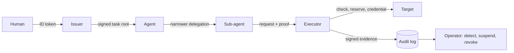

# agentic-security-reference

A runnable reference for giving AI agents authority without giving them credentials.

An agent can be steered by what it reads, so this design treats it as an untrusted insider. The agent never holds a secret. It carries a signed, task-scoped chain of authority, and a separate process checks every action before it happens, performs it, and records evidence.

It is for engineers and security teams who run agents that deploy, move money, or touch production, and want a pattern they can read, run and adapt.

## Try it

Python 3.13:

```sh ci
python -m pip install -e ".[dev]"
ruff check
ruff format --check
mypy
pytest -q
```

Run the eleven scenarios. Each prints what happened and checks it:

```sh runnable
python -m demo
```

The last line should read `11 of 11 scenarios passed`.

## What the demo shows

| # | Scenario | What it proves |
|---|---|---|
| 1 | happy path | a human's task reaches an effect through one delegation hop |
| 2 | budget exhaustion | a task's budget holds across every hop |
| 3 | root revocation | revoking a task stops every agent below it |
| 4 | mid-chain revocation | revoking one link stops only that subtree |
| 5 | stolen credential | a copied credential fails at the target |
| 6 | rogue issuer | a validly signed task from an untrusted issuer is refused |
| 7 | kill levers | stop new effects, or stop authority, independently |
| 8 | crash recovery | a fault between steps never issues a second credential |
| 9 | enforced mode | the agent process holds no secret and still gets its effect |
| 10 | persona deviation | an unusual in-scope action is flagged and the executor suspended |
| 11 | alert stops a chain | an alert revokes a live delegation chain mid-task |

## How it works



1. **A human starts a task.** The issuer verifies their OIDC ID token and signs a task root: who asked, for what purpose, with what scope, budget and expiry.
2. **Agents delegate.** Each hop signs a narrower link. Scope and budget can only shrink.
3. **The executor checks every action.** It runs in its own process and holds all secrets. It verifies the chain, scope, cost and policy, and reserves budget in the ledger.
4. **It performs the effect.** It mints a short-lived credential bound to that one operation. The agent never sees the credential.
5. **It records evidence, and the operator can stop things.** Identity comes from the verified chain, never from the request. The operator suspends new credentials or revokes authority, by hand or from alerts.

Details: [docs/ARCHITECTURE.md](docs/ARCHITECTURE.md).

## What is protected

| Mode | What it is | What you can claim |
|---|---|---|
| Advisory | agent-guard inside the agent's process | records and steers; not a security boundary |
| Enforced | the executor in its own process holds all secrets | the agent process holds no secret. Set `agent_uid` and `agent_gid` to run the agent as another OS user that cannot read the executor's files (tested on Linux in CI); without them, an agent on the same user can read them |
| Isolated | enforced, plus a VM or container around the agent | not built |

Not covered, among others:

- **Egress:** no egress proxy is built, so in enforced mode the agent must run with network egress denied.
- **Real targets:** the targets are fakes that verify the credential binding; a real target that accepts any bearer token gets weaker protection.
- **Detection:** it runs after the fact, so a flagged action has already happened.
- **Scale:** the ledger is one SQLite file on one host.
- **Prompt injection itself:** this limits what a compromised agent can do, not whether it is compromised.

Full list, each defence tied to a test: [docs/THREAT_MODEL.md](docs/THREAT_MODEL.md).

## Use it

The code here is glue plus a demo. The primitives live in two libraries, pinned to commit SHAs in `pyproject.toml`:

- [agent-warrant](https://github.com/agent-rails/agent-warrant): signed task roots, delegation chains, and the budget and revocation ledger.
- [agent-guard](https://github.com/agent-rails/agent-guard): policy decisions, the credential injector, evidence and detection.

| You have | Use | You get |
|---|---|---|
| Only a tool-call hook | agent-guard alone | policy decisions and audit, advisory mode |
| Services that must accept delegated authority | agent-warrant alone | `verify_chain` in your service, plus the ledger for revocation and budgets |
| An agent that must not hold credentials | both, through the executor here | enforced mode as demonstrated |

A scenario is an ordinary function. This one builds a world, issues a task root and sends a request:

```python runnable
from demo.agents import Agent
from demo.world import World

world = World()
try:
    world.start_in_process()
    agent = Agent("release-bot")
    world.root_for(agent)
    response = world.send(agent, "deploy.service", "env/staging/api", {"image": "api:1"}, "n1")
    assert response["status"] == "done", response
finally:
    world.stop()
```

## Why

Three failure patterns recur once agents get real access:

- **A copied token works anywhere.** A long-lived token on one machine is used from another. Here each credential is bound to one operation and the executor's key, and lives seconds; a copy fails at the target (scenario 5).
- **A side door skips the checks.** A service accepts a request that did not go through the normal process. Here every effect passes the executor, and the targets accept only credentials it injected (scenarios 1 and 5).
- **Authority outlives the decision to stop.** Delegations keep working after the shutdown. Here revoking a task, a link or a tenant stops every chain below it on the next request (scenarios 3, 4, 7 and 11).

## Documentation

| Document | Read it for |
|---|---|
| [docs/ARCHITECTURE.md](docs/ARCHITECTURE.md) | the request path, layer coverage, records and signing, MCP fit |
| [docs/THREAT_MODEL.md](docs/THREAT_MODEL.md) | what is defended, with tests, and what is not |
| [docs/DECISIONS.md](docs/DECISIONS.md) | why it is built this way |
| [docs/OPERATIONS.md](docs/OPERATIONS.md) | what to do when something refuses to continue |
| [docs/RISK_MAPPING.md](docs/RISK_MAPPING.md) | a partial mapping to OWASP and NIST names |

| Path | Contents |
|---|---|
| `executor/` | the executor: protocol, core, server, operator, credentials, targets |
| `issuer/` | the OIDC task-root issuer |
| `demo/` | the scenarios and the world they run in |
| `tests/` | unit and integration tests; the scenarios also run as tests |

Every fenced `sh` or `python` block in these docs is either run by `tests/test_docs_commands.py` or is a command that `.github/workflows/ci.yml` runs.

## License

Apache-2.0.
