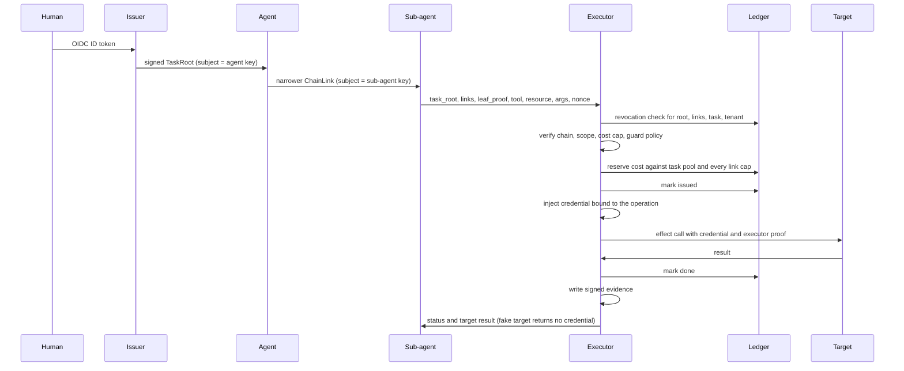

# Architecture

## Primitives

1. Identity: an agent is a public key. It is named in evidence for attribution; it is not authorization.
2. Task grant: a signed `TaskRoot` (tenant, principal, purpose, budget, max depth, scope, expiry) and `ChainLink` records that narrow it per hop.
3. Check on every effect: scope, cost cap and guard policy, evaluated in the executor.
4. Stateful effect budgets: the task pool and each link's cap, reserved in the ledger per operation.
5. Evidence: signed audit records stamped with identity from the verified chain.
6. Inventory: derived from evidence by agent-guard (`guard inventory`); it covers only agents whose effects pass the executor.
7. Detection: deterministic persona checks over the evidence log, off the request path.

## Request to effect

Order in `executor/core.py::Executor._handle`: strict decode, `verify_chain` (audience is the executor id, request digest is the agent-computable digest of tool, resource, arguments and nonce), scope, cost, guard decision, suspension check, in-flight claim on the operation id, `open_task`, `reserve`, `mark_issued`, `inject`, `perform`, `mark_done`. Before the ledger marks an operation issued, a failure at any step is a refusal with a recorded reason. After that, a failure is never reported as a refusal: it returns `outcome_unknown` with the `op_id`. A ledger failure after the effect gives `effect_done_ledger_not_updated`; any other failure gives `internal_error_after_issue`, and its terminal evidence row may be missing. Reconcile such an operation against the target's own record ([OPERATIONS.md](OPERATIONS.md)). Evidence marks a call executed only once the target was called.

Digests: the leaf proof binds the request digest, which the agent can compute. The credential binds the operation digest, which covers fields only the executor chooses (cost, expiry, verdict). The operation id is derived by the executor from tenant, task, leaf record and request digest; the wire request has no `op_id` field. A repeated identical request (same nonce) is refused as already done; a new nonce is a new operation.

## Layer coverage

Statuses: built (a test here exercises it), limit (built, with a stated limit), not covered.

| Layer | Status | What exists | Shown by |
|---|---|---|---|
| Human request | limit | `issuer/oidc.py` verifies an OIDC ID token and derives principal and tenant from claims by configuration; a task root never outlives the token. An ID token can be exchanged for several task roots until it expires. Per-request human approval is not wired: a `require_human` guard verdict is refused. | `tests/test_issuer.py::test_valid_token_yields_a_signed_task_root_with_claims_from_the_token` |
| Issuer | limit | The executor trusts issuers listed in its trust policy, each with allowed tenants, principals, budget and depth. Keys are pinned in configuration. Key custody and rotation are not covered. Entra or Okta sit in front of the issuer and produce the ID token; they are never in the trust policy. | `tests/test_executor.py::test_unlisted_issuer_is_refused`, `demo/scenarios.py::rogue_issuer` |
| Task root | built | Signed by the issuer; tenant, budget and scope come from signed fields. | `demo/scenarios.py::happy_path` |
| Delegation | built | Links narrowing scope and budget per hop. Signature and hash-chain checks are agent-warrant's; rejecting an altered link is not tested here. | `demo/scenarios.py::budget_exhaustion`, `demo/scenarios.py::mid_chain_revocation` |
| Agent | limit | The agent tooling holds a private signing key and chain, but no executor service credential. In separate-user mode it runs as its own OS user. Its public key identifies it for attribution without attesting to the agent software. No sandbox is built. | `tests/test_enforced_process.py::test_stateless_agent_receives_no_executor_secret_and_still_gets_effect`, `tests/test_separate_user.py::test_agent_running_as_another_user_cannot_read_secrets_but_gets_its_effect` |
| Decision | limit | Scope match, a policy-owned cost schedule with a per-call cap, and the guard's policy. A model judge is not on the request path. | `tests/test_executor.py::test_guard_policy_can_deny_a_tool_the_scope_allows`, `tests/test_executor.py::test_agent_cannot_state_its_own_cost` |
| Credential | limit | One short-lived credential per operation, bound to the executor key, the audience and the operation digest. That binding is enforced only where the target verifies it; the fake targets here do. A target that cannot verify it should receive a short-lived, narrow token held only by the executor; that path is not built here. Target results are forwarded without filtering; a real integration must restrict returned fields and errors. | `demo/scenarios.py::stolen_credential` |
| Effect | limit | Fake targets that accept injected credentials only. No real target and no egress proxy: in enforced mode the agent must run with egress denied, and that is not enforced by this code. | `tests/test_executor.py::test_happy_path_performs_the_effect_once_and_spends_the_cost` |
| Evidence | limit | Signed v2 audit records; principal, actor, parent actor, purpose, tenant, task root and grant hash come from the verified chain; host is recorded as a claim. HMAC with a shared key: a compromised producer can forge records, and suppression is not detected. | `tests/test_evidence_identity.py::test_identity_comes_from_the_verified_chain` |
| Detection | limit | agent-guard's persona checks (first use of a tool or resource, rate, hours) run over the signed log and route alerts to suspend or to revoking the task root. Each detected event is acted on at least once and recorded once its action reaches a final outcome; routing refuses to act on a log with a row that fails verification. They run after the fact: the flagged call was already performed. The delegation depth check is skipped because the audit schema has no depth field. | `tests/test_operator.py::test_alert_for_a_new_resource_revokes_the_live_chain_mid_task`, `demo/scenarios.py::persona_deviation` |
| Stop | limit | Effect stop: `Operator.suspend` refuses new credentials; only the named releaser resumes. Authority stop: revoke a binding, task or tenant in the ledger. A credential already issued stays valid until its ttl. | `demo/scenarios.py::kill_levers`, `tests/test_operator.py::test_suspend_refuses_new_credentials_and_only_the_releaser_resumes` |

## Records and signing

The reader surface is four records: `TaskRoot`, `ChainLink`, `LeafProof` and `Operation`. agent-warrant's v1 `Grant` and `RevocationList` are legacy and are not used here.

| Scheme | Used for | Key holder |
|---|---|---|
| Ed25519 | `TaskRoot` (issuer key), `ChainLink` (parent holder key), `LeafProof` (leaf holder key), the executor's proof over a credential (executor key) | each signer; verifiable without sharing a secret |
| HMAC-SHA256 | audit records (audit key), alerts (alert key), the credential MAC (the target's secret) | shared between signer and verifier |

The alert key protects alerts written by a separate detector. Alerts the operator detects and routes itself are signed and checked inside one process, so the key adds nothing there.

## MCP

No MCP client is built here. The design fit: the executor would be the MCP client and hold the credentials, obtain a separate token per MCP server audience, and never forward a task grant or any token it received. The [MCP authorization specification](https://modelcontextprotocol.io/specification/2026-07-28/basic/authorization) requires a server to accept only tokens issued for it and never to accept or transit any other token (version 2026-07-28, checked on 2026-11-09).

## Kill levers

- Effect stop: the executor checks the shared suspension state before reserving anything; a suspended executor reserves no budget.
- Authority stop: revocations are rows in the ledger. `verify_chain` asks the ledger about the root, every link, the task and the tenant, and refuses the request when the ledger cannot be read.
- The two are independent: resuming does not undo a revocation, and a revocation does not need a suspension.

## Scope of revocation and budgets

Revocation and budgets are properties of one ledger. The executor checks the ledger it is configured with. A delegation presented to a different executor, or to a service that does not consult that ledger, is not stopped by it. A cross-organization stop therefore works only through an executor that checks the root's ledger. The ledger is a single SQLite file on one host. Several processes on that host may share it; several hosts may not.

## Evidence and assurance

The executor writes a `release` and a `terminal` record for each call that reaches the credential injector, and a `decision` record for each refusal before that. Detection reads them.

## Components in this repository

| Component | File |
|---|---|
| Frame protocol, request digest, operation id | `executor/protocol.py` |
| Orchestration of one request | `executor/core.py` |
| Unix socket server: one allowed peer user checked against kernel credentials; same-user mode uses a 0600 socket in a 0700 directory, separate-user mode a 0660 socket in a 0710 directory owned by the agent group | `executor/server.py` |
| Peer credentials (`SO_PEERCRED`, `LOCAL_PEERCRED`) | `executor/peer.py` |
| Operator: suspend, revoke, route alerts | `executor/operator.py` |
| Credential minting, secret store, executor proof | `executor/credentials.py` |
| Fake targets | `executor/targets.py` |
| OIDC task-root issuer | `issuer/oidc.py` |
| Scenarios and the world they run in | `demo/scenarios.py`, `demo/world.py` |
| Live run: the agent's MCP tool server and the run script | `live/agent_tools.py`, `live/run.py` |
